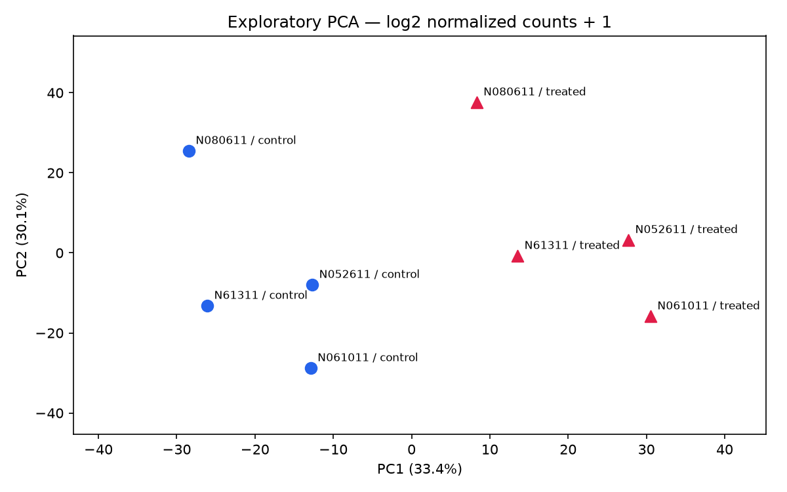

# AIRWAY RNA-seq Reproducibility Study

How closely do Python and R agree on the response to dexamethasone in human airway smooth muscle cells? Using four treated/control donor pairs, PyDESeq2 and DESeq2 agreed on the direction of change for **all 852 genes with strong effects in the R reference**. Across 16,139 tested genes, **308 crossed the adjusted p-value threshold in only one implementation**. The [scientific report](docs/research/REPORT.md) examines that discrepancy and what changes when one donor is left out.



*Exploratory sample-level QC using log-transformed normalized counts. The paired differential-expression model uses raw counts.*

**Archived software:** [Zenodo v1.0.1 · DOI 10.5281/zenodo.24572737](https://doi.org/10.5281/zenodo.24572737)

## Reproduce locally

Run these commands from the repository root in PowerShell. Use Docker Desktop with Linux containers. Preparation requires network access; analysis and tests run offline. No host Python packages, cloud account or paid model API are required.

```powershell
docker build --target pipeline -t rnaseq-pipeline:validated .
New-Item -ItemType Directory -Force results | Out-Null
$projectPath = (Get-Location).Path
$imageId = docker image inspect rnaseq-pipeline:validated --format '{{.Id}}'
docker run --rm --network none --read-only --cpus 2 --memory 4g --tmpfs /tmp:rw,nosuid,size=512m --env "RNASEQ_IMAGE_ID=$imageId" --mount "type=bind,src=$projectPath\results,dst=/output" rnaseq-pipeline:validated python -m src.cli run --data /data --output /output/run-1 --config /app/config.json
```

Each output directory must be empty or absent. Reusing a nonempty directory fails rather than overwriting results. The image contains the preserved inputs; its root filesystem is read-only.

Outputs: differential_expression.csv, normalized_counts.csv, gene_filter.csv, qc.json, analysis_summary.json, run_manifest.json and four figures under figures/. The manifest records input/code/configuration hashes, package versions, image ID, elapsed time and parent-process peak RSS. Worker memory is excluded. Scientific warnings are preserved in the summary and printed.

```powershell
docker run --rm --network none --read-only --tmpfs /tmp:rw,nosuid,size=512m rnaseq-pipeline:validated python -m pytest -q -p no:cacheprovider
docker run --rm --network none rnaseq-pipeline:validated pip check
```

## Research materials

- [Scientific report](docs/research/REPORT.md) and [prespecified research protocol](docs/research/PROTOCOL.md)
- [Input provenance](data/manifest.json), [fixed model configuration](config.json) and [independent R validation](reference/VALIDATION.md)
- [Python/R comparison](reference/comparison.json), [reproduction evidence](evidence/reproduction.json) and [research workflows](research/README.md)
- [Offline scientific task](benchmark/TASK.md), [grading rubric](benchmark/RUBRIC.md) and [rehearsal results](benchmark/REHEARSAL.md)
- [Code license](LICENSE) and [upstream data attribution](data/LICENSE-NOTES.md)

<details>
<summary>Architecture, independent R reproduction and evaluator commands</summary>


### Independent reference

```powershell
docker build -f reference/Dockerfile -t rnaseq-reference:validated reference
docker run --rm --network none --read-only --tmpfs /tmp:rw,nosuid,size=512m --mount "type=bind,src=$projectPath,dst=/work" rnaseq-reference:validated Rscript /work/reference/run_deseq2.R /work/data /work/reference/output /work/config.json
docker run --rm --network none --mount "type=bind,src=$projectPath,dst=/work" -w /work rnaseq-pipeline:validated python -m src.compare results/run-1/differential_expression.csv reference/output/differential_expression.csv --output reference/comparison.json
```

R preparation checks every package against reference/packages.lock.csv. It rejects repository drift; it does not restore old package tarballs automatically. Preserve the validated image for offline reruns. Base images are pinned by digest and Python transitives by exact version; binary availability from upstream repositories is still an online rebuild dependency.

data/manifest.json records official source URLs, export versions, sample mapping and SHA-256 hashes. reference/export_airway.R documents the one-time acquisition. .gitattributes preserves LF bytes across Windows Git checkouts so hashes remain valid. Annotation is historical Ensembl 75 / GRCh37.p13; gene IDs are not collapsed to symbols.

### Demonstrative task and evaluator

Read [benchmark/TASK.md](benchmark/TASK.md), [SOURCES.md](benchmark/SOURCES.md) and [RUBRIC.md](benchmark/RUBRIC.md). Participants write analyze.py and receive only data, instructions, configuration and installed libraries.

```powershell
docker build --target participant -t rnaseq-participant:validated .
# Freeze evaluator-only gold after the passing R comparison:
docker run --rm --network none --mount "type=bind,src=$projectPath,dst=/work" -w /work rnaseq-pipeline:validated python -m benchmark.prepare --source results/run-1 --validation reference/comparison.json
# Host Python uses only the standard library for the evaluator-owned runner:
py -3.13 -m benchmark.runner --source YOUR_SUBMISSION --output results/submission-1 --receipt results/receipts/submission-1.json
# Mount the evaluator workspace only in this separate grading container:
docker run --rm --network none --mount "type=bind,src=$projectPath,dst=/work" -w /work rnaseq-pipeline:validated python -m benchmark.grader --submission results/submission-1 --gold benchmark/gold --receipt results/receipts/submission-1.json --human-review benchmark/HUMAN_REVIEW.json --output results/grade-1.json
```

Before gold preparation, copy the reviewed interpretation into results/run-1/interpretation.md. The pipeline calculates results; the interpretation is separately authored and reviewed.

[benchmark/REHEARSAL.md](benchmark/REHEARSAL.md) records the correct solution (85 automatic points, human review pending), rejection of real unpaired and reversed-contrast executions, and read-only/network/failure probes.

The runner enforces 2 CPUs, 4 GiB, 128 processes, 30-minute timeout, no network, non-root execution, read-only root/input/source and no Docker socket or evaluator mounts. Receipts and logs remain outside participant mounts. This is basic container isolation, not a claim of protection against every hostile-kernel exploit.

Automatic grading totals 85 points; human review adds up to 15. A score of 85 alone is pending review, not approved. Human review checks source, method, figures and biological claims. A copied reference solution rehearses the mechanics; it is not a measured AI-agent attempt. Known public data can be memorized; future generalization requires unseen tasks.

</details>
