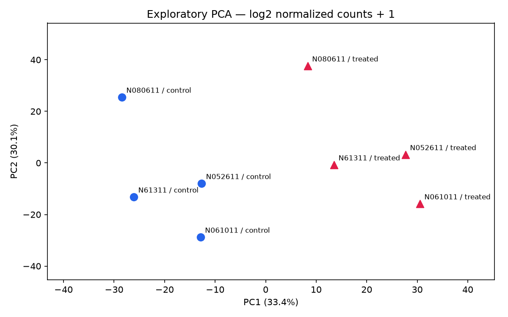

# AIRWAY RNA-seq Reproducibility Study

## Question and design

When two implementations fit the same paired RNA-seq model, how closely do they agree on treatment effects and on which genes pass a significance threshold? We reanalyzed eight human airway smooth muscle samples from four donors. Each donor contributed a control and a dexamethasone-treated sample, both without albuterol. The donor is the biological replicate. The extension completed on October 5, 2026 examined donor sensitivity, pathway analysis, external metadata and simulations. [Study protocol](PROTOCOL.md) · [Input provenance](../../data/manifest.json)

## Methods

We aligned raw integer counts by sample ID and retained genes with at least 10 counts in at least four samples. PyDESeq2 0.5.4 and R/DESeq2 1.50.2 used the same donor-adjusted design (`~ donor + condition`), treated/control contrast, ratio size factors, parametric dispersion fit and two-sided Wald test. Positive log2 fold change indicates higher expression after treatment. We used unshrunken effects and Benjamini–Hochberg adjusted p-values below 0.05. The additional magnitude cutoff for exploratory highlights describes point estimates. [Fixed configuration](../../config.json) · [Baseline reproduction](BASELINE.md)

The prespecified cross-engine check required matching gene IDs, finite effect estimates, Spearman correlation of at least 0.95 and direction agreement of at least 95% among R reference genes with adjusted p-value below 0.01 and absolute log2 fold change of at least 1. Four sensitivity fits each omitted one complete donor pair while retaining the baseline gene universe. [Independent validation](../../reference/VALIDATION.md) · [Donor sensitivity protocol and results](ROBUSTNESS.md)

## Results and verification

| Baseline result | PyDESeq2 | R/DESeq2 |
|---|---:|---:|
| Genes tested after filtering 63,677 input genes | 16,139 | 16,139 |
| Genes with adjusted p-value below 0.05 | 3,879 | 4,081 |
| Significant only in this implementation | 53 | 255 |
| Genes with missing adjusted p-values | 0 | 313 |

Both implementations called 3,826 genes significant. Effect estimates had Spearman correlation **0.9999944**, and their signs agreed for **852 of 852** strong reference genes. Despite that agreement, 308 significance classifications differed. Normalized counts agreed to numerical precision. R's independent filtering accounted for its 313 missing adjusted p-values. The diagnostic analysis identified differences in low-degree-of-freedom dispersion estimation, but their contribution to the 308 classification differences remains unresolved. Two offline Python baseline runs reproduced identical tables. [Machine-readable comparison](../../reference/comparison.json) · [Diagnostics](PYTHON-R.md) · [Reproduction record](../../evidence/reproduction.json)

*PC1 and PC2 explained 33.4% and 30.1% of the variation in the log-transformed normalized counts used for exploratory QC. All eight samples were retained.*

### Sensitivity and external evidence

- **Donor removal.** All 1,090 Python baseline genes with absolute log2 fold change of at least 1 retained their direction in every fold. Of these, 1,003 stayed within 0.5 log2 units of the full-data estimate in every fold. The number of significant genes ranged from 2,476 to 3,456 across the four Python fits. [Donor-level results](ROBUSTNESS.md)
- **Pathways.** At baseline, CAMERA found zero of 4,265 eligible terms below FDR 0.05 when inter-gene correlation was estimated. Fixing correlation at 0.01 yielded 11 significant terms. The report also records overrepresentation analysis and separate GOseq sensitivities for gene length and expression. [Pathway results](PATHWAYS.md)
- **External validation.** The available metadata could not establish the sample-level treatment contrast for the external dataset. The audit recorded `insufficient_metadata` and stopped before fitting a differential-expression model. [External protocol](EXTERNAL-PROTOCOL.md) · [Audit outcome](EXTERNAL-RESULTS.md)
- **Simulations.** PyDESeq2 completed 3,200 replicates across 16 scenarios, and DESeq2 completed 800 across four scenarios with four pairs, all with zero fit failures. For example, in the four-pair PyDESeq2 scenarios with 10% differential expression, increasing the simulated interaction SD from 0 to 0.5 reduced estimated power from 0.7982 to 0.5676. Each engine generated its own datasets, so between-engine comparisons are descriptive. [Simulation design, uncertainty and results](SIMULATION.md)

## Interpretation and limits

The two implementations closely reproduced effect sizes in this cohort. A gene's threshold classification was more sensitive to the implementation and to which donors were included. Four donors leave only three residual degrees of freedom for the full model. The Python run retained its warning about dispersion-prior estimation. The overlapping leave-one-donor-out fits characterize sensitivity within these four donors. Generalization to other donors, clinical effects and pathway mechanisms requires additional evidence. [Scientific assessment](../SCIENTIFIC-ASSESSMENT.md)

The software also supplies 12 synthetic scientific tasks with separate fixtures and rubrics. The recorded rehearsal checked evaluator behavior. Independent agent performance, external scientific review, human pathway interpretation and rubric validation remain unmeasured in this study. [Agent evaluation record](AGENT-EVALUATION.md) · [Study status at the October 5 run](STATUS.md)

## Sources

- Himes et al. (2014). Original airway smooth muscle RNA-seq study. [PLOS ONE](https://doi.org/10.1371/journal.pone.0099625)
- Bioconductor. Experiment design, samples and counts for the airway dataset. [airway vignette](https://bioconductor.org/packages/release/data/experiment/vignettes/airway/inst/doc/airway.html)
- Marcos Cabral Netto. AIRWAY software and reproducibility archive. [Zenodo v1.0.1](https://doi.org/10.5281/zenodo.24572737)
